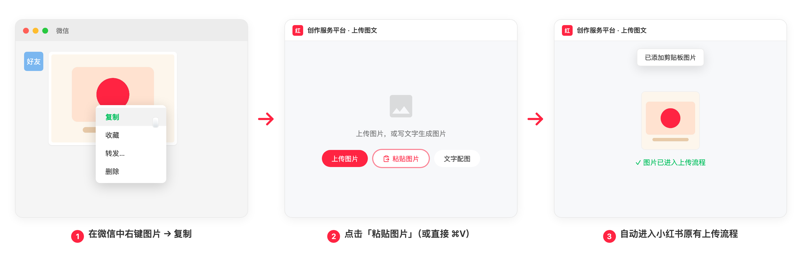
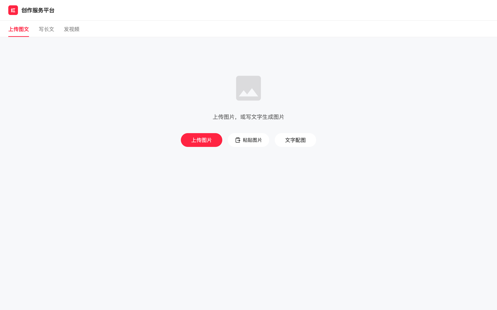
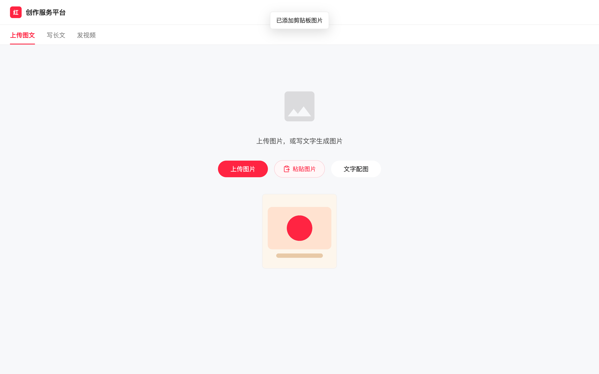

# rednote-image-upload

将系统剪贴板中的图片直接添加到[小红书创作服务平台](https://creator.xiaohongshu.com/publish/publish)的 Chrome 扩展，**支持从微信复制的图片**。

## 安装

1. 打开 `chrome://extensions/`，启用右上角「开发者模式」。
2. 点击「加载已解压的扩展程序」，选择本仓库目录。
3. 刷新小红书发布页。

## 使用



- 复制图片（截图、浏览器图片、**微信聊天图片**均可）。
- 在发布页点击「粘贴图片」按钮，或在页面空白处按 `⌘V` / `Ctrl+V`。
- 图片进入小红书原有的校验、预览与上传流程；图片编辑页可继续追加。
- 在标题、正文等文本编辑区粘贴时不受影响。

支持 PNG、JPG、JPEG、WebP；大小、数量（18 张上限）与分辨率遵循小红书规则。

### 界面示意

初始上传页，「粘贴图片」按钮位于「上传图片」右侧：



粘贴成功后，顶部出现提示，图片进入预览与上传流程：



> 示意图基于模拟页面截取，实际界面以小红书创作服务平台为准。

## 微信图片兼容原理

微信 Mac 复制聊天图片时，剪贴板里同时写入了**文件引用**（`public.file-url`，指向微信缓存中的 `.jpg`）和多种图片格式（TIFF/PNG/JPEG…）。

Chromium 在 macOS 上的类型探测逻辑（`ui/base/clipboard/clipboard_mac.mm` → `GetStandardFormats`）规定：

> 剪贴板含 `public.file-url` 时，只暴露 `text/uri-list`，**故意忽略图片**（兼容 Finder 复制文件的行为，crbug.com/553686）。

因此 `navigator.clipboard.read()` 拿不到任何 `image/*` 类型，而 paste 事件走另一条代码路径（`ReadFiles`），会携带真实文件。

为此，按钮点击采用两级读取：

1. **异步剪贴板 API**（`navigator.clipboard.read()`）——常规截图等场景；
2. **粘贴桥**：拿不到图片类型时，聚焦一个隐藏的 `contenteditable` 元素并执行 `document.execCommand("paste")`（扩展持有 `clipboardRead` 权限），触发与 `⌘V` 完全相同的 paste 事件，从中提取真实文件后注入。

页面 `⌘V` 路径作为兜底始终可用。

## 实现结构

```
manifest.json        MV3，仅 clipboardRead 权限，仅匹配 creator.xiaohongshu.com/publish/*
src/content.js       全部逻辑：入口识别 → 剪贴板读取（两级）→ DataTransfer 注入 file input
src/content.css      按钮与提示条样式
assets/              图标
```

工作流程：找到小红书隐藏的 `<input type="file" multiple>`（初始上传页 / 图片编辑页两种入口，`MutationObserver` 持续挂载按钮）→ 读取剪贴板图片 → `DataTransfer` 写入 `input.files` → 派发 `change` 事件 → 复用平台自身上传流程。

## 权限与隐私

- `clipboardRead`：仅在点击按钮或粘贴时读取剪贴板。
- 无后台服务、无统计代码、无任何第三方网络请求。
- 只处理受支持的图片类型，不读取、不保存剪贴板文本。

## 诊断

页面 Console 过滤 `rednote-upload`：

- `读取剪贴板图片 { source: "async-clipboard" | "paste-bridge" }` —— 成功及所用路径；
- `异步剪贴板 API 未返回图片类型，尝试粘贴桥` —— 微信图片触发了兼容路径；
- `粘贴失败 { errorCode }` —— 失败原因（`BRIDGE_BLOCKED` 表示浏览器拦截了程序化粘贴，此时请直接 `⌘V`）。

## 许可

Apache-2.0。粘贴图标基于 [Lucide](https://lucide.dev) `clipboard-paste`（ISC）。